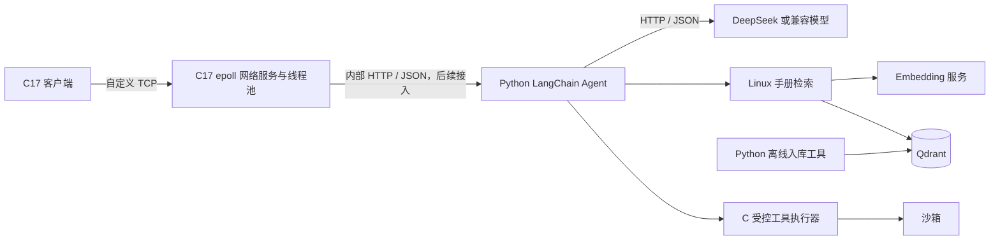

# RAGent

RAGent 是一个面向 Linux 系统编程课程的多客户端 Agent。客户端、网络服务和受控执行边界使用 C17；Python Agent 使用 LangChain 编排模型和工具。客户端通过自定义 TCP 协议接入，C 网络服务计划通过内部 HTTP/JSON 调用 Python Agent。Linux 手册知识库的离线解析与入库工具计划使用 Python。

> 当前状态：C17 网络服务已接入单 epoll 线程、固定线程池、有界队列和 eventfd。CHAT、RAG、CMD 和默认 AGENT 请求仍返回固定响应；尚未接入 Python Agent、模型、知识库或命令执行沙箱。

## 目标架构

系统保留四种入口：默认的 AGENT 模式可组合工具；CHAT 仅调用模型；RAG 必须检索 Linux 知识库后再调用模型；CMD 使用受限操作工具并由模型解释结果。用户不需要自行判断复杂请求应使用哪种模式。

Agent 为每个请求保留原始问题和对话上下文。模型通过 OpenAI 兼容的 Chat Completions HTTP 接口收到问题及当前模式允许的工具定义。Agent 校验工具名和参数，执行可并行的独立调用，将结果写回上下文后继续请求模型。达到调用上限、超时或工具失败时，结果说明已完成和失败的步骤。最终响应沿用原始 request_id，包含回答、检索来源和操作摘要。



客户端与 C 网络服务继续使用已确认的 20 字节定长头和 UTF-8 JSON 消息体。C 网络服务与 Python Agent 计划使用内部 HTTP/JSON，Agent 与大模型、Embedding 服务及 Qdrant 使用 HTTP/JSON；当前无 Web 前端或双向流式输出需求，不引入 WebSocket。

知识库首期以中文 Linux 命令手册和基础知识资料为主，覆盖常见命令、文件与权限、进程、网络、服务及系统调用。只导入 Linux 资料，不把项目文档作为知识库原始语料。离线入库先使用普通 Python 脚本，不引入 LangChain。

## 当前客户端

构建并启动：

```bash
cmake -S . -B build -DCMAKE_BUILD_TYPE=Debug
cmake --build build -j 2
ctest --test-dir build --output-on-failure
./build/agent-server --config config/agent.json
./build/agent --host 127.0.0.1 --port 9000
```

客户端默认进入 Agent 模式，普通输入直接发送为 AGENT_REQUEST。可以使用 /chat、/rag、/cmd 切换单一模式，/back 返回 Agent 模式。当前这些模式都返回固定模板，不调用后端服务。

单次请求示例：

```bash
./build/agent --host 127.0.0.1 --port 9000 --mode agent --query "解释 epoll 并查看当前内存情况"
```

也支持 --mode chat|rag|cmd。服务器默认监听 127.0.0.1:9000，当前最多接入128个连接，每连接待发送缓冲上限为2 MiB；这些是当前网络设置，不代表未来端到端并发目标。

Ubuntu 24.04 构建依赖：C17 编译器、CMake 3.16以上、pkg-config、json-c 开发包和 Python 3（仅运行集成测试）。例如：

```bash
sudo apt install build-essential cmake pkg-config libjson-c-dev python3
```

项目没有模型或外部服务依赖时也可构建和运行当前网络闭环。默认4个工作线程，任务和完成队列各256项，可通过配置字段 `worker_threads`、`task_capacity`、`result_capacity` 或对应命令行参数调整。队列满时返回 `SERVER_BUSY`。当前真实模型首选 DeepSeek，使用可配置的 OpenAI 兼容 Chat Completions HTTP 接口；凭据只从运行时配置或环境读取，不提交到仓库。

## 后续开发路线

| 阶段 | 目标 |
|---|---|
| 1 | C17 客户端、epoll Agent、TCP 协议及 Agent 固定响应闭环（已完成） |
| 2 | 固定工作线程池、有界任务与完成队列、过载处理（当前） |
| 3 | Python LangChain Mock Agent 和工具调用闭环、请求上下文、工具校验、调用上限及部分失败响应 |
| 4 | 中文 Linux 手册/基础资料的 Python 离线导入、Embedding 与 Qdrant 检索 |
| 5 | OpenAI 兼容 Chat Completions 接口及 DeepSeek 配置，后续可替换模型 |
| 6 | 只读操作和受控写操作；工作区写入在隔离容器中运行 |
| 7 | 集成、故障和并发压测；目标为1000个端到端请求，模型依硬件能力限流排队 |
| 8 | 部署、演示和文档交付 |

性能目标暂不规定固定时延。压测应报告机器与模型配置、吞吐、排队时间、端到端延迟分位数和失败率，再按实际单机体验确定门槛。1000并发是后续全链路目标，不是当前阶段承诺。

## 命令工具安全路线

只读操作可在白名单内自动执行。其他白名单操作也可自动执行，但写操作只作用于专用沙箱工作区；宿主机系统级变更逐次确认，并只能通过固定、参数校验过的操作。任意 Shell 字符串不作为工具参数，也不使用 system() 或 /bin/sh -c。

后续沙箱按阶段实现：非特权身份、专用工作区挂载、只读根文件系统、资源和输出限制，再加入 seccomp 与 cgroups。工作区写操作可使用 rootless 容器；不得把 Docker 管理套接字暴露给 Agent。当前阶段没有命令执行或沙箱代码。

## 文档

- [TCP协议规范](docs/protocol.md)：客户端与 Agent 的帧格式、请求类型和响应约定。
- [模块接口草案](docs/module-interfaces.md)：C 模块职责、所有权和后端 HTTP 边界。
- [开发计划](docs/development-plan.md)：阶段目标、验收条件和安全路线。
- [网络验证说明](docs/testing.md)：当前自动化测试覆盖范围。
- [开发约定](AGENTS.md)：代码风格、中文注释和交付规则。

## 协作

功能在 feature/* 分支开发；公共协议和接口变更按小组协作约定确认；阶段交付应包含可运行演示和失败路径测试。不要提交构建目录、模型文件、密钥或运行日志。

本项目当前未指定开源许可证。未经项目成员确认，请勿默认将代码作为开源项目分发。
