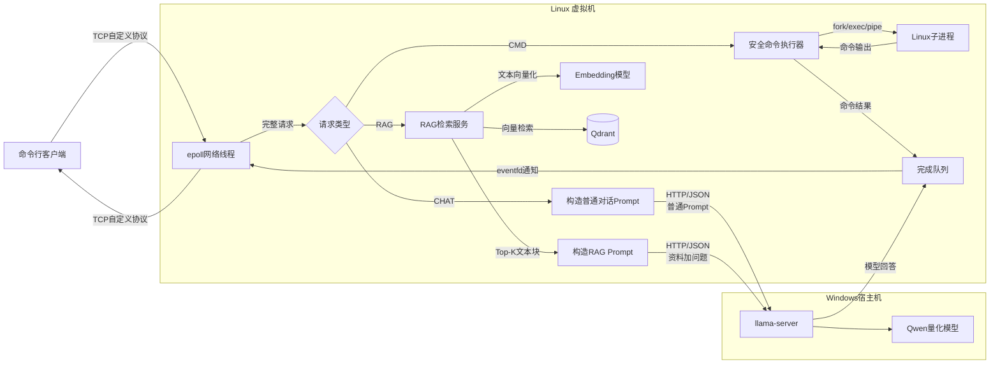

# RAGent

RAGent 是一个面向 Linux 系统编程课程的多用户智能 Agent。系统通过 C++ 命令行客户端接收用户请求，由 C++ Agent 服务器完成网络通信、并发调度和业务路由，并根据请求类型执行普通对话、本地知识库检索问答或受控的 Linux 命令。

> 当前状态：项目处于设计冻结和第一阶段开发准备期，功能尚未实现。仓库将按照“先最小网络闭环，再逐步接入线程池、RAG和大模型”的顺序开发。

## 项目目标

RAGent 计划支持三类请求：

| 类型 | 功能 | 处理路径 |
|---|---|---|
| `CHAT` | 普通大模型对话 | Agent → llama-server |
| `RAG` | 根据本地资料回答 | Agent → RAG检索 → llama-server |
| `CMD` | 执行允许的Linux操作 | Agent → 安全检查 → Linux子进程 |

课程开发重点包括：

- TCP Socket与非阻塞I/O；
- 单`epoll`网络线程；
- 固定工作线程池和有界任务队列；
- 自定义应用层协议；
- 多客户端并发与过载控制；
- Embedding、Qdrant和RAG流程；
- HTTP/JSON服务调用；
- `fork/exec/pipe`、超时与子进程回收；
- 命令白名单和安全边界。

本项目不训练大模型，也不从零实现向量数据库或模型推理框架。

## 总体架构



推荐部署方式：

- Ubuntu虚拟机：C++客户端、Agent服务器、RAG服务、Embedding、Qdrant和命令执行器；
- Windows宿主机：使用RTX 4050运行`llama-server`和Qwen量化模型；
- Agent通过HTTP/JSON调用RAG服务和模型服务。

## 命令行交互

正式客户端程序名为`agent`，服务端程序名为`agent-server`。

```bash
./agent-server --config config/agent.json
./agent --host 127.0.0.1 --port 9000
```

以上命令是计划中的最终接口，当前阶段尚未提供可执行程序。

客户端启动后进入主界面：

```text
  _____            _____             _
 |  __ \     /\   / ____|           | |
 | |__) |   /  \ | |  __  ___ _ __  | |_
 |  _  /   / /\ \| | |_ |/ _ \ '_ \ | __|
 | | \ \  / ____ \ |__| |  __/ | | || |_
 |_|  \_\/_/    \_\_____|\___|_| |_| \__|

RAG Agent CLI
Connected to 127.0.0.1:9000

输入 / 查看可用命令，输入 /help 查看帮助。
agent>
```

第一版采用显式模式，不调用大模型判断请求类型：

```text
agent> /chat
chat> 什么是TCP？
chat> /back

agent> /rag
rag> 本项目为什么使用epoll？
rag> /back

agent> /cmd
cmd> 查看磁盘空间
cmd> /back

agent> /exit
```

主要命令：

| 命令 | 作用 |
|---|---|
| `/chat [问题]` | 进入CHAT模式，或执行一次CHAT请求 |
| `/rag [问题]` | 进入RAG模式，或执行一次RAG请求 |
| `/cmd [操作]` | 进入CMD模式，或执行一次CMD请求 |
| `/back` | 返回`agent>`主界面 |
| `/help` | 显示帮助 |
| `/status` | 查看服务状态 |
| `/list` | 在CMD模式查看允许的操作 |
| `/exit` | 断开连接并退出客户端 |

客户端模式只是输入快捷方式。每条网络请求都会在消息头中携带独立的`message_type`，服务端不保存客户端当前模式。

客户端还将提供单次请求方式，用于脚本和并发测试：

```bash
./agent \
  --host 127.0.0.1 \
  --port 9000 \
  --mode rag \
  --query "什么是epoll？"
```

## 并发模型

RAGent采用：

```text
单epoll网络线程 + 全局固定工作线程池
```

- 网络线程只负责连接、非阻塞收发、协议解码和连接状态；
- 工作线程负责RAG检索、模型调用和命令执行等耗时任务；
- 请求通过有界任务队列进入线程池；
- 完成结果通过完成队列返回，并由`eventfd`唤醒网络线程；
- 工作线程不直接向客户端Socket发送数据；
- 队列满时返回`SERVER_BUSY`，不允许请求无限堆积。

## 消息协议

协议设计采用“固定20字节二进制消息头＋UTF-8 JSON消息体”的长度前缀协议：

```cpp
enum class MessageType : uint16_t {
    CHAT_REQUEST = 1,
    RAG_REQUEST  = 2,
    CMD_REQUEST  = 3,
    RESPONSE     = 100,
    ERROR        = 101,
    PING         = 200,
    PONG         = 201
};

struct MessageHeader {
    uint32_t magic;
    uint16_t version;
    uint16_t message_type;
    uint32_t body_length;
    uint64_t request_id;
};
```

上述结构体仅展示逻辑字段，不代表线上内存布局。协议使用大端序，消息体最多1 MiB，必须逐字段序列化。请求通过`request_id`匹配，响应允许乱序返回。

详细约定见以下文档；当前为待全组确认的设计提案，尚未实现：

- [TCP协议规范](docs/protocol.md)：消息头、JSON消息体、错误码、连接行为和验收场景。
- [模块接口草案](docs/module-interfaces.md)：内部所有权、队列、RAG、LLM和命令执行器接口。
- [开发计划](docs/development-plan.md)：开发阶段、分工原则和阶段验收标准。

## 开发阶段

| 阶段 | 目标 |
|---|---|
| 0 | 冻结需求、协议、模块接口和分工 |
| 1 | 客户端与`epoll`服务器完成固定响应闭环 |
| 2 | 加入固定线程池、任务队列和10客户端测试 |
| 3 | 使用Mock服务跑通CHAT、RAG和CMD三条路径 |
| 4 | 接入Embedding、Qdrant和真实RAG检索 |
| 5 | 接入`llama-server`和真实模型回答 |
| 6 | 实现安全命令执行器 |
| 7 | 完成故障、并发和过载测试 |
| 8 | 完成部署脚本、文档和课程演示 |

当前第一个里程碑：

> 在Ubuntu中编译并启动C++ `epoll`服务器，多个客户端能够发送带`request_id`的消息并收到固定响应。

在完成这个闭环以前，不接入Qdrant、Embedding和真实大模型。

## 计划目录

目录将随开发阶段逐步创建，不预先生成大量空文件：

```text
RAGent/
├── CMakeLists.txt
├── README.md
├── config/
├── docs/
├── include/
│   ├── protocol/
│   ├── net/
│   ├── core/
│   ├── rag/
│   ├── llm/
│   └── command/
├── src/
│   ├── client/
│   ├── server/
│   ├── protocol/
│   ├── net/
│   ├── core/
│   ├── rag/
│   ├── llm/
│   └── command/
├── services/
├── scripts/
├── tests/
└── data/documents/
```

## 开发环境

计划使用：

- Ubuntu Linux；
- C++17；
- GCC/G++；
- CMake；
- GNU Readline；
- Python 3与FastAPI；
- Qdrant；
- llama.cpp / `llama-server`；
- Qwen量化模型。

具体安装、构建和运行命令将在对应阶段实际验证后补充，README不记录未经验证的命令。

## 协作约定

- `main`只保存通过阶段验收的稳定版本；
- 功能在`feature/*`分支开发；
- 公共协议和头文件修改前由全组确认；
- 合并前至少由另一名成员阅读；
- 每个阶段必须提供可运行演示和失败路径测试；
- 不提交模型文件、构建目录、虚拟环境、密钥和运行日志。

建议里程碑标签：

```text
v0.1-network
v0.2-thread-pool
v0.3-mock-agent
v0.4-rag
v0.5-llm
v0.6-command
v1.0-final
```

## 安全说明

CMD路径不会直接执行用户原始字符串，也不会使用`system(user_input)`或`/bin/sh -c`。命令必须经过操作映射、程序白名单、参数校验、超时控制和输出大小限制；未识别的操作直接拒绝。

## License

本项目当前未指定开源许可证。未经项目成员确认，请勿默认将代码作为开源项目分发。
