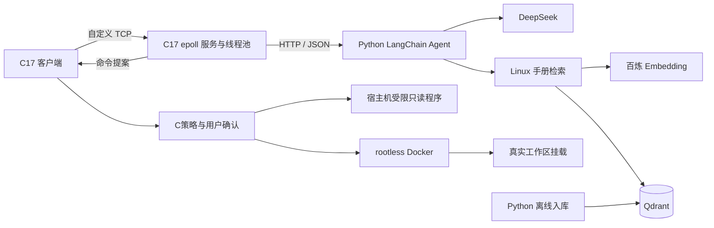

# RAGent

RAGent 是面向 Linux 系统编程课程的多客户端 Agent。C17 客户端通过自定义 TCP
协议接入 C 网络服务，工作线程通过 HTTP/JSON 调用 Python LangChain Agent。
Agent 支持 DeepSeek 问答、Linux 手册检索和客户端分级命令执行；写操作须确认后在rootless容器中执行。

## 一键本机部署

Ubuntu 24.04 已安装并启动 Docker、具备 Python 3.11 以上时，可执行：

```bash
cp .env.example .env
# 编辑 .env，填写 DeepSeek 和百炼 Embedding 配置；已有 .env 时不覆盖。
bash scripts/start.sh --deploy
```

脚本在需要时通过 sudo 安装构建与手册依赖，创建或复用本机 Qdrant，安装 Python 依赖，
构建 C 程序，导入默认八本手册并验证检索，再启动 DeepSeek Agent 与 C 服务。
入库和检索会调用百炼并产生 API 用量，服务启动本身不发起 DeepSeek 问答。
Qdrant 地址使用 `http://127.0.0.1:6333`，业务端口从 `config/agent.json` 读取。
默认知识库为 `linux_manual_v4`，使用段落与条目两种粒度融合检索；本机质量验收与
回退方式见[多粒度验收](docs/rag-evaluation-v4.md)。已有 `.env` 升级时需同步集合名
和 `RAGENT_RETRIEVAL_STRATEGY=context`；旧集合保留，不能直接混入新分块。
现有服务端口被占用时脚本退出，不终止已有服务；已有集合不匹配时需使用新集合名。

日常启动直接执行 `bash scripts/start.sh`（也可带 `--skip-import`）。这一路径只检查本地
配置、可执行文件、Qdrant 集合身份与非空状态，然后启动服务，不安装、不构建、不入库，
也不发起付费检索检查。缺少构建产物时会提示先部署。
更新代码后使用 `bash scripts/start.sh --deploy --skip-import` 重新安装和构建；
部署路径仍会执行一次真实检索检查，产生少量 Embedding 用量。
脚本保持前台运行，显示日志目录和客户端命令。在另一个终端进入仓库后执行：

```bash
./build/agent --timeout-ms 130000
```

使用自定义端口时以脚本打印的客户端命令为准。Ctrl+C 停止脚本启动的 Python 和 C 服务，
Qdrant 容器与数据卷保留。日志在被忽略的 `artifacts/deploy-*/` 中。
手动安装、构建及启动步骤如下。

## 安装与构建

Ubuntu 24.04 需要 C17 编译器、CMake 3.16 以上、pkg-config、json-c、libcurl 和
Python 3.11 以上。Python 依赖与开发工具配置见 `pyproject.toml`。

```bash
sudo apt install build-essential cmake pkg-config libjson-c-dev libcurl4-openssl-dev python3-venv procps
python3 -m venv .venv
.venv/bin/pip install -e '.[dev]'
cmake -S . -B build -DCMAKE_BUILD_TYPE=Release -DPython3_EXECUTABLE="$PWD/.venv/bin/python"
cmake --build build -j 2
ctest --test-dir build --output-on-failure
```

安装后可以使用 `ragent-server`、`ragent-manual`、`ragent-evaluate` 和
`ragent-evaluate-evidence` 命令，也支持 `python -m`。评测数据与快照不随 Python 包
分发，评测需从仓库根目录运行或显式指定路径。依赖声明使用版本范围，尚无锁定文件。

## 启动真实模型与检索

准备本地 `.env`，填写 `.env.example` 中的 DeepSeek、百炼 Embedding 和 Qdrant
配置。程序从环境读取配置，不自动加载 `.env`。Qdrant 需已有手册集合，部署与导入
步骤见[知识库说明](docs/rag.md)。在可信 shell 中运行：

```bash
set -a
source .env
set +a
.venv/bin/ragent-server --model deepseek --retrieval qdrant
```

另一终端启动 C 服务（保持运行）：

```bash
./build/agent-server --config config/agent.json
```

再打开一个终端启动交互客户端：

```bash
./build/agent --timeout-ms 130000
```

启动时显示 RAGent 文字 Logo，默认进入 AGENT 模式，直接输入问题即可。
`/chat`、`/rag`、`/cmd` 切换模式，`/back` 返回 AGENT；`/help` 查看帮助，`/exit` 退出。
客户端默认等待 130 秒，可通过 `--timeout-ms` 调整。响应较慢时，终端显示等待动画和
已等待秒数，完成或失败后自动清除。Ctrl+C 关闭连接后，服务端丢弃尚未执行的任务，
中止正在进行的内部 HTTP 请求，并协作取消 Python 后续调用；已经提交云端的调用
可能仍产生用量。客户端不会自动重试。重定向输出或非交互终端不显示动画。
例如：

```text
agent> 解释 Linux 文件权限
agent> /rag
rag> 如何列出隐藏文件？
rag> /back
agent> /exit
```

| 模式 | 当前行为 |
|---|---|
| CHAT | 直接调用模型，不提供工具 |
| RAG | 强制先检索 Linux 手册，再交给模型回答并回传来源 |
| CMD | 模型提出Shell命令，客户端按风险分级确认与执行 |
| AGENT | 模型自主组合检索、诊断及已启用的文件工具 |

C 请求预算由 agent_timeout_ms 配置，默认 125 秒，从完整请求入队开始，包含排队及
HTTP 调用。过期任务不再执行；Python 接收剩余预算并与自身默认 120 秒取较小值。
客户端等待默认 130 秒。结果队列与网络发送不属于业务执行预算。
单次模型调用超时和输出 Token 上限从环境读取。没有成功工具结果时总超时返回错误；
已有工具结果时可返回明确标注未完成的部分结果。模型失败不会切换为 Mock 回答。

## 本地 Mock 与网络测试入口

```bash
.venv/bin/ragent-server
./build/agent-server --config config/agent.json
./build/agent
```

Python 不带参数时使用 Mock 模型及检索；`--retrieval qdrant` 可单独启用真实检索。
`config/agent.json` 统一配置网络、线程池和 Python 后端，排队与 HTTP 调用的合计预算为 125 秒。
模型与检索方式由 Python 启动参数选择。独立网络验证可不带 `--config` 启动 C 服务，
此时四种请求均返回固定响应。

Python 可通过 `--workers 1..4` 或 `RAGENT_AGENT_WORKERS` 设置固定工作进程数，默认1。
模型并发和检索线程配置是整组总量，按进程均分；每个进程独立持有HTTP客户端与只读手册
索引。增加进程的性能收益需按实际机器和上游服务测量，容量验收见
[高并发配置与测量](docs/performance-concurrency.md)。

## CMD 工具

命令作用于客户端启动目录。只读命令自动执行；写入与向外行动须逐条确认，
在rootless容器内执行，写入反映到真实工作区，断连后保留。
首次在客户端设备执行 `bash scripts/setup-command-runtime.sh`，然后在任意任务目录
运行 `~/.local/bin/ragent`。网络、凭证、SSH和隔离限制见[命令执行说明](docs/command-policy.md)。
服务端与客户端须同时升级，TCP v2拒绝旧版本。

## 可选：单次请求

只发送一个问题并退出时，使用 `--query`，可通过 `--mode` 指定模式。
单次请求不显示 Logo，仅输出回答和来源：

```bash
./build/agent --timeout-ms 130000 --mode rag --query '如何列出隐藏文件？'
```

## 架构与边界



网络服务使用单 epoll 线程、固定工作线程池、有界任务与完成队列和 eventfd 通知。
默认 64 个工作线程，任务队列 1024 项、完成队列 256 项，最多 2048 个连接；每连接待发送缓冲上限 2 MiB。
TCP 使用 20 字节大端头和 UTF-8 JSON，支持半包、粘包、部分写入及 request_id 关联。
工作线程不直接写客户端 Socket，断连后的迟到结果按连接标识丢弃。

Agent 每请求独立保存消息和工具结果，最多调用模型 4 次，每轮最多 4 个工具；
DeepSeek 模型默认并发上限为 32，可用 RAGENT_MODEL_CONCURRENCY 设置。
检索使用独立的 8 线程池，可用 RAGENT_RETRIEVAL_WORKERS 设置。
环境示例通过 NO_PROXY 让 DeepSeek 和百炼接口直连；需要代理访问时调整该项。
对话无跨请求历史和流式输出；工作区固定为客户端启动目录，文件在任务结束后保留。
知识库包含 8 本手册、1456 个段落或条目检索单元，默认融合两种粒度；质量结果与限制见
[多粒度验收](docs/rag-evaluation-v4.md)。

## 开发与后续工作

```bash
.venv/bin/python -m compileall -q python rag tools tests
.venv/bin/pyright --pythonpath .venv/bin/python
.venv/bin/black --check python rag tools tests
```

网络、Agent、真实检索和 DeepSeek 已打通，构建与自动化检查结果见
[验证说明](docs/testing.md)。CMD使用客户端分级策略与rootless工作区执行；
跨设备部署仍需独立验收。断连取消、截止时间传播、
资源关闭和本地就绪检查已实现。
默认单进程与可选四进程配置均完成三轮32在途、600请求真实模型测试。
四进程另完成真实千在途1000/1000成功，吞吐8.822请求/秒、混合P95为106.894秒。
本轮吞吐优化已结束，不再以9请求/秒为目标；后续uvloop与工具绑定复用仅有受控验证，
未重新进行付费千请求压测；这些数据不包含客户端命令确认与执行。配置、测量口径与版本边界见
[并发配置与测量](docs/performance-concurrency.md)。

## 文档与协作

- [开发计划](docs/development-plan.md)：阶段状态和后续验收。
- [CMD 开发指导](docs/cmd-development.md)：只读诊断、C 执行器与沙箱写操作路线。
- [TCP 协议](docs/protocol.md)：帧格式和响应约定。
- [模块接口](docs/module-interfaces.md)：模块职责、所有权和内部 HTTP 接口。
- [验证说明](docs/testing.md)：检查命令、测试覆盖与限制。
- [工具说明](tools/README.md)：回归、压测与知识库评测工具的用途和前置条件。
- [高并发配置与测量](docs/performance-concurrency.md)：当前参数、真实模型扫描及受控规模验证。
- [知识库](docs/rag.md)：Qdrant、手册入库、快照和检索配置。
- [来源级评测](docs/rag-evaluation-v1.md)与[证据块评测](docs/rag-evidence-v1.md)：检索质量。
- [编码与交付约定](AGENTS.md)。

功能在 feature/* 分支开发；不兼容公共接口变更遵守小组确认约定。
不提交密钥、构建产物、模型、快照或运行日志。项目未指定开源许可证，分发需经成员确认。
